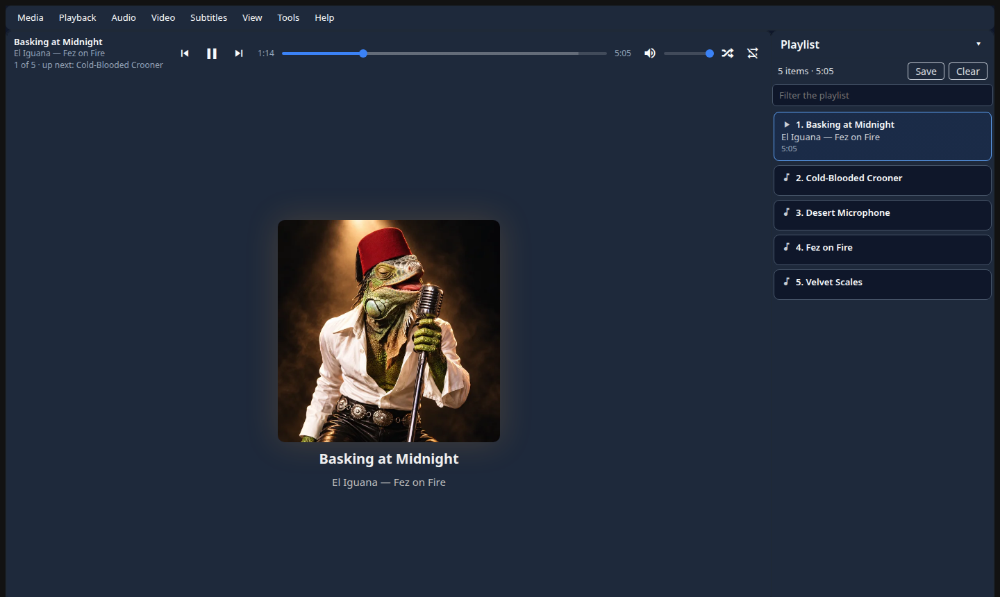

<p align="center"></p>

# LizardKing

*I am the Lizard King. I can do anything.*

A stand-alone desktop media player in the spirit of VLC. It runs in its own
window via [Electron](https://www.electronjs.org/), with its own icon and an
entry in your application menu, and no browser, login or key. Open any file on
your disk and it plays: what the player can decode is served as it is, and
everything else (HEVC, ten-bit video, AC-3, DTS, WMA, AVI, …) is transcoded on
the fly by ffmpeg, with the full length shown and seeking anywhere.

Built with [pyTincture](https://github.com/pytincture/pytincture) (the
interface is Python, running in Pyodide) and [wapyt](https://github.com/WAwesome-AI/wa_pytincture_widgetset)
(the widgets, including its MediaPlayer). The Electron shell starts LizardKing's
Python server on this computer only and stops it when you close the window. It
can also run in an ordinary browser tab. Named for Jim Morrison, and for El Iguana.



- **Open** files, folders (with subfolders, in natural order) and M3U playlists
  from a dialog that browses your disk, or an http(s) / HLS address
- **DLNA media servers**: *Media → Open Media Server* (Ctrl+D) finds a NAS
  (MiniDLNA, Plex, Jellyfin, …) on your network; browse it in its own folders
  (*NAS › Video › Recently Added*) and play from it like a local file,
  transcoding and seeking included, with thumbnails of its videos and its
  album art
- **Plays directly** when it can, **transcodes** when it must (NVENC if you have
  it, else libx264), and tells you which and why in *Media Information*
- **Subtitles**: `.srt` / `.ass` / `.vtt` beside the file, and text subtitles
  inside it
- **Audio tracks**: switch mid-film and carry on from the same place
- **Playlist** panel; save it as M3U; repeat and shuffle
- **Recent files** and **resume where you left off**
- Speed, jump to time, next frame, **A→B loop**, **snapshot**, fit and zoom,
  full screen, dark and light
- VLC's keyboard shortcuts where they fit (press `?`)

## Requirements

- Python 3.13 and [uv](https://docs.astral.sh/uv/)
- **ffmpeg and ffprobe** on your PATH
- **Node.js** (`npm`) for the Electron desktop app; or, without it, a
  Chromium-based browser or Firefox
- Checkouts of [wapyt](https://github.com/WAwesome-AI/wa_pytincture_widgetset)
  beside this one (`../wa_pytincture_widgetset`), at the commit in
  `pyproject.toml` (`[tool.lizardking] wapyt-ref`)

## Install

```bash
git clone https://github.com/WAwesome-AI/wa_pytincture_widgetset.git
git clone https://github.com/El-Iguana/lizardking_wapyt.git
cd lizardking_wapyt
git -C ../wa_pytincture_widgetset checkout "$(sed -n 's/^wapyt-ref = "\(.*\)"/\1/p' pyproject.toml)"
uv sync
../wa_pytincture_widgetset/scripts/dev_wheel.sh appcode   # the widgets the interface loads
desktop/install.sh                                         # Electron, the icon, the menu entry
```

## Run it

Start **LizardKing** from your application menu. Video and audio files can
also be opened with it from your file manager, or from a terminal:

```bash
desktop/node_modules/electron/dist/electron desktop ~/Videos/some-film.mkv   # files or folders are optional
```

Electron starts the server on a free port on this computer only (127.0.0.1),
so nothing on your network can reach it, and stops it, with any running
transcodes, when you close the window. Run `desktop/install.sh` again if you
move the checkout.

### In a browser instead

```bash
uv run python service.py ~/Videos/some-film.mkv
```

This opens `http://127.0.0.1:8777/lizardking/` (or `localhost:8777`) in your
browser; stop it with Ctrl+C.

## Settings

| Variable | Default | |
|---|---|---|
| `LIZARDKING_PORT` | `8777` | Port on 127.0.0.1 in a browser (the desktop app picks a free one) |
| `LIZARDKING_ENCODER` | `auto` | `auto` (NVENC if it works, else libx264), or any ffmpeg H.264 encoder |
| `LIZARDKING_DATA` | `~/.local/share/lizardking` | Recent files, positions, settings |
| `LIZARDKING_CACHE` | `~/.cache/lizardking` | Transcode segments and subtitles; emptied at start |
| `LIZARDKING_FFMPEG` / `LIZARDKING_FFPROBE` | `ffmpeg` / `ffprobe` | Other binaries |
| `LIZARDKING_LOG_LEVEL` | `warning` | uvicorn's log level |

## Tests

```bash
uv run --group dev pytest -q                              # includes a real ffmpeg transcode
uv run --with playwright python tests/e2e/ui_check.py     # the whole app in Chromium
```

## More

- [docs/spec.md](docs/spec.md): how it works and why
- [ROADMAP.md](ROADMAP.md): what is next
- [CLAUDE.md](CLAUDE.md): notes for working on the code

MIT licence.
